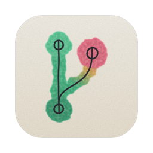
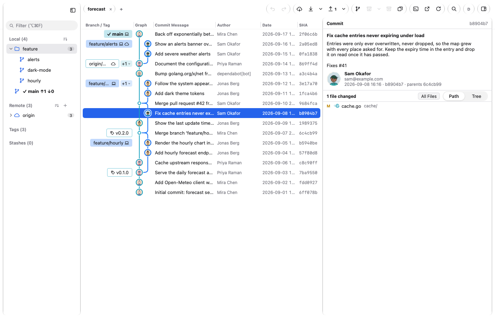
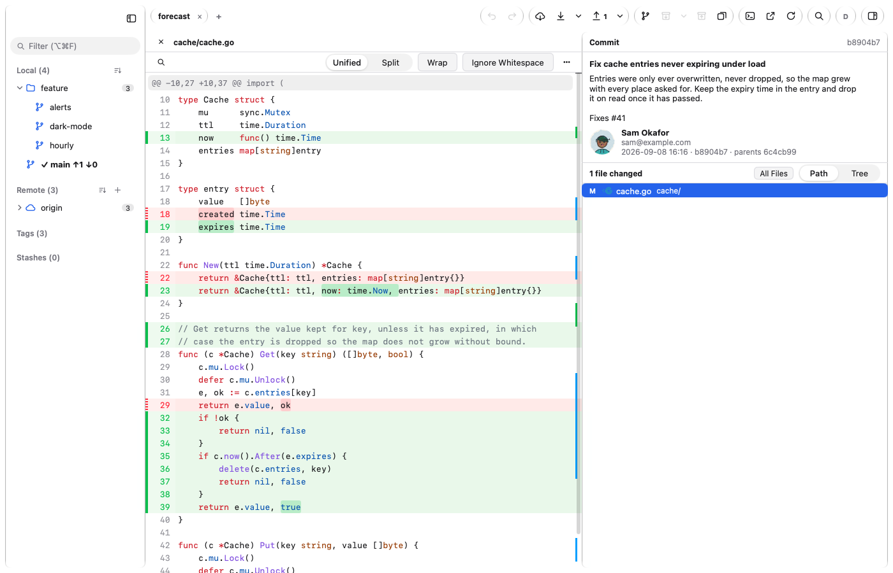
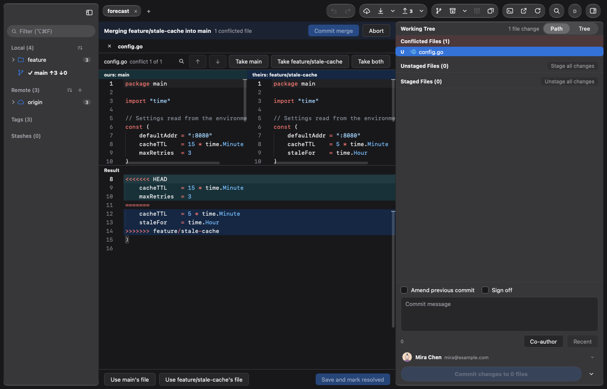

<p align="center">
  
</p>

<h1 align="center">MyTwig</h1>

<p align="center">A fast, native Git client for macOS, Windows and Linux</p>

<p align="center"><b>English</b> | <a href="README.zh-CN.md">简体中文</a></p>

MyTwig is a desktop Git client for macOS, Windows and Linux. It shows every branch of a repository as a commit graph, and lets you stage, commit, branch, merge, rebase, stash and resolve conflicts with the mouse or the keyboard. It is a native app written in Go: there is no Electron, and no account or server of ours is involved.

This repository holds **release builds and signed update manifests only**. It contains no source code.

**[Download the latest release →](https://github.com/HeroSizy/mytwig-releases/releases/latest)** · [All releases](https://github.com/HeroSizy/mytwig-releases/releases)

**Quick install.** macOS and Linux (Terminal):

```sh
curl -fsSL https://github.com/HeroSizy/mytwig-releases/releases/latest/download/install.sh | sh
```

Windows (PowerShell):

```powershell
[Net.ServicePointManager]::SecurityProtocol = [Net.ServicePointManager]::SecurityProtocol -bor [Net.SecurityProtocolType]::Tls12; irm https://github.com/HeroSizy/mytwig-releases/releases/latest/download/install.ps1 | iex
```

See [Download and install](#download-and-install) for what these do, how to update and uninstall, manual downloads, and Homebrew, Scoop and winget.

<picture>
  <source media="(prefers-color-scheme: dark)" srcset="screenshots/main-dark.png">
  
</picture>

| Diff view | Conflict editor |
| --- | --- |
|  |  |

## Features

- **Commit graph** of every branch, with branch and tag labels, author avatars, and resizable, reorderable columns. It stays fast on very large histories.
- **Staging and committing**: stage or discard whole files, hunks or single lines. The commit box has amend, sign-off, co-authors, commit templates and summary-length hints.
- **Branches, merges and rebases** by drag and drop. Conflicts are predicted before you merge, and an interactive rebase lets you reorder, squash, reword and drop commits.
- **Conflict editor** with ours and theirs side by side above an editable result.
- **Undo and redo** for most operations. The **Operation Timeline** can restore the repository to how it was before a rebase, reset, merge, pull and more.
- **Split a commit**, or your uncommitted changes, into several commits by file, hunk or line. **Absorb** folds staged fixes into the commits they belong to.
- **Pull requests and issues** from GitHub (including Enterprise), GitLab, Gitea/Forgejo and Bitbucket Cloud. You can review GitHub pull requests inside the app.
- **Menu bar / tray companion** that shows the pull requests waiting on you, CI status and where your recent repositories stand.
- **Optional AI help** using your own provider: commit messages, explanations of a commit or a change, pull request descriptions, conflict suggestions and split plans. Supported providers include Anthropic, OpenAI-compatible APIs, Gemini, local Ollama or LM Studio, and the `claude`, `codex`, `copilot` and `gemini` CLIs. Requests go straight from your machine to the provider you chose.
- Also included: file history, blame and line history, bisect, reflog, stashes in the graph, worktrees, submodules, Git LFS, Git Flow, patches, commit signing (GPG, SSH, X.509), SSH key management, profiles, custom commands, a built-in terminal and a command palette.
- **English and Simplified Chinese**, light and dark themes, accent colors, and macOS 26 Liquid Glass styling (on macOS).

## System requirements

| Platform | Builds | Notes |
| --- | --- | --- |
| macOS | Apple silicon (arm64) and Intel (amd64), a build for each | macOS 12 Monterey or later |
| Windows | x64 (amd64) and ARM64 | 64-bit Windows 10 or 11 |
| Linux | x64 (amd64) and ARM64 | Needs GTK 3 and WebKitGTK 4.1. The `.deb` installs them as dependencies. |

On every platform, **Git 2.32 or later** must be installed. MyTwig uses the `git` you already have, along with its config, credential helpers, hooks and SSH setup. A few features need a newer Git: staged-only stash needs 2.35, and conflict prediction and stacked rebases need 2.38. If Git is missing or too old, the window tells you how to install or update it.

## Download and install

There are three ways to install MyTwig. The one-command install is the recommended one.

1. [Install with one command](#install-with-one-command): our install scripts, for macOS, Linux and Windows.
2. [Package managers](#package-managers): Homebrew, Scoop and, soon, winget.
3. [Download manually](#download-manually): the disk image, installer or package from the release page.

### Install with one command

**macOS and Linux** (Terminal):

```sh
curl -fsSL https://github.com/HeroSizy/mytwig-releases/releases/latest/download/install.sh | sh
```

**Windows** (PowerShell):

```powershell
[Net.ServicePointManager]::SecurityProtocol = [Net.ServicePointManager]::SecurityProtocol -bor [Net.SecurityProtocolType]::Tls12; irm https://github.com/HeroSizy/mytwig-releases/releases/latest/download/install.ps1 | iex
```

Both install the latest version for your user, without admin rights, and open MyTwig. On macOS the script picks the build for your Mac (Apple silicon or Intel) and puts MyTwig in `/Applications` (or `~/Applications` if you can't write to `/Applications`) after checking the download's Ed25519 signature against MyTwig's key. On Linux the script checks the same signature too; this needs OpenSSL 3.0 or later (Debian 12, Ubuntu 22.04, Fedora 36, RHEL 9 and later). Because curl, unlike a browser, doesn't mark the download as quarantined (the script itself doesn't touch the quarantine flag), macOS shows **no Gatekeeper "Open Anyway" prompt**. On Windows the script checks the installer's SHA-256 against the release's `SHA256SUMS` and runs it silently; if Microsoft Defender SmartScreen still shows "Windows protected your PC", click **More info**, then **Run anyway** (the installer isn't code-signed yet).

**Update.** MyTwig updates itself (see [Updates](#updates)). You can also run the same command again at any time: it installs the latest version over the one you have, keeping your settings.

**Uninstall.** On macOS or Linux, run:

```sh
curl -fsSL https://github.com/HeroSizy/mytwig-releases/releases/latest/download/install.sh | sh -s -- --uninstall
```

This keeps your settings. On Windows, uninstall MyTwig from **Settings → Apps**.

### Package managers

If you already manage your apps with a package manager, you can install MyTwig with it instead. Update it through the package manager, as shown for each.

#### Homebrew (macOS)

```sh
brew install --cask herosizy/tap/mytwig
```

Homebrew marks the download as quarantined, as a browser does, so the first launch needs the same ["Open Anyway"](#first-launch-open-anyway) step as a manual download, and it may be needed again after `brew upgrade`, which installs a new copy. To update, run `brew upgrade --cask mytwig`. The app's own updater also works in a Homebrew install, but Homebrew then keeps showing the version it installed until you run that command. `brew uninstall --cask mytwig` removes the app and keeps your settings; add `--zap` to remove the settings, caches and logs too.

#### Scoop (Windows)

```powershell
scoop bucket add herosizy https://github.com/HeroSizy/scoop-bucket
scoop install herosizy/mytwig
```

Scoop installs MyTwig in its own folder (`~\scoop\apps\mytwig`) with a Start menu shortcut, without admin rights. To update, run `scoop update mytwig`. The app's own updater also works, but Scoop then keeps showing the version it installed. `scoop uninstall mytwig` removes it; your settings stay in `%APPDATA%\MyTwig`.

#### winget (Windows) — coming soon

```powershell
winget install HeroSizy.MyTwig
```

MyTwig isn't in the winget repository yet; this command will work once it is. It runs the same installer as the manual download, for your user only. Update it with `winget upgrade HeroSizy.MyTwig`; MyTwig's own updater works too.

### Download manually

You can also download the files from the [latest release](https://github.com/HeroSizy/mytwig-releases/releases/latest) yourself. The asset names below are for 0.2.0. GitHub shows spaces in asset names as dots.

| Platform | File | What it is |
| --- | --- | --- |
| macOS | `MyTwig 0.2.0 arm64.dmg` / `MyTwig 0.2.0 amd64.dmg` | Disk image: `arm64` for Apple silicon (M1 and later), `amd64` for Intel Macs |
| Windows | `MyTwig Setup 0.2.0 amd64.exe` / `… arm64.exe` | Installer (per user, no admin rights needed) |
| Linux | `mytwig_0.2.0_amd64.deb` / `…_arm64.deb` | Debian/Ubuntu package |
| macOS, Linux | `install.sh` | The one-command install script. On Linux, it can also install a `mytwig-0.2.0-linux-<arch>.tar.gz` next to it |
| Windows | `install.ps1` | The one-command install script |
| (all) | `SHA256SUMS` | SHA-256 checksums of the installers, archives and scripts. It lists the names with spaces where GitHub shows dots |
| (all) | `update-<platform>.json`, `mytwig-0.2.0-<platform>.tar.gz` | Used by the auto-updater (and, for Windows, by Scoop). You don't need to download these. |

#### macOS

1. Download the disk image for your Mac: `MyTwig 0.2.0 arm64.dmg` for Apple silicon (M1 and later), `MyTwig 0.2.0 amd64.dmg` for Intel. Not sure? Apple menu → **About This Mac** shows **Chip: Apple M…** on Apple silicon and **Processor: … Intel …** on Intel.
2. Open it and drag **MyTwig** into **Applications**.
3. Open MyTwig from Applications. The first launch needs one extra step (see below).

##### First launch: "Open Anyway"

This build is **not signed with an Apple Developer ID and not notarized by Apple**. It only has an ad-hoc signature, so Gatekeeper blocks it the first time you open it. This is expected. To allow it:

**macOS 15 Sequoia and later**

1. Double-click MyTwig. A dialog says Apple could not verify it. Click **Done**.
2. Open **System Settings → Privacy & Security** and scroll down to **Security**.
3. Next to the message about "MyTwig", click **Open Anyway**, then confirm with your password or Touch ID.
4. Open MyTwig again and click **Open**.

**macOS 12–14**

Control-click (or right-click) MyTwig in Applications, choose **Open**, then click **Open** in the dialog. You can also use **System Settings → Privacy & Security → Open Anyway** as above.

You only need to do this once. Alternatively, if you trust the download, you can run this in Terminal:

```sh
xattr -dr com.apple.quarantine /Applications/MyTwig.app
```

#### Windows

1. Run `MyTwig Setup 0.2.0 amd64.exe`, or the `arm64` installer on ARM devices.
2. The installer isn't code-signed yet, so **Microsoft Defender SmartScreen** may warn you about it. Click **More info**, then **Run anyway**.
3. MyTwig installs for your user only, in `%LOCALAPPDATA%\Programs\MyTwig`. It adds a Start menu shortcut and, if you choose, a desktop shortcut. You can uninstall it from **Settings → Apps**.

#### Linux

**Option A: install script (recommended, updates itself).** This installs into `~/.local` for your user, without root. It adds a desktop entry, and the app can update itself afterwards:

```sh
curl -fsSL https://github.com/HeroSizy/mytwig-releases/releases/latest/download/install.sh | sh
```

You can also download `install.sh` and the `mytwig-0.2.0-linux-<arch>.tar.gz` for your architecture into the same folder and run `sh install.sh`. To remove MyTwig, run `sh install.sh --uninstall`. This keeps your settings. The script doesn't install WebKitGTK, but it tells you the command to run if it's missing.

**Option B: Debian/Ubuntu package.**

```sh
sudo apt install ./mytwig_0.2.0_amd64.deb   # or _arm64.deb
```

The package installs to `/opt/mytwig` and **does not update itself**. To upgrade, install the newer `.deb`.

## Updates

MyTwig checks this repository for new versions. It checks at launch, if the last check was more than 30 minutes ago, and then every 30 minutes. The steps are:

1. It downloads `update-<platform>.json` from the **latest release** of this repository. The platforms are `darwin-arm64`, `darwin-amd64`, `windows-amd64`, `windows-arm64`, `linux-amd64` and `linux-arm64`: each build reads its own, so an Apple silicon Mac stays on the arm64 build.
2. If the manifest names a newer version, MyTwig shows it in a window with its release notes. You can install it, skip that version or be reminded later.
3. Installing downloads the archive the manifest points to (or a smaller delta from your version, when one exists). It then checks the archive's size and its **Ed25519 signature against the public key built into the app**. An update that isn't signed with MyTwig's key is refused.
4. The new version is put in place next to the old one, and the old one is restored if that fails. The new version runs the next time MyTwig starts, or when you click **Relaunch**.

Downloads use HTTPS, from GitHub. No account or token is needed, and nothing about you or your repositories is sent.

To change this, go to **Settings → General → Updates**. There you can turn the background checks on or off, choose whether found updates are installed without asking, and check now. On macOS you can also use **MyTwig → Check for Updates…**. The same Settings row shows the running version and when it last checked.

Some installs can't update themselves, and Settings says so. These are development builds, the `.deb` install (it's in `/opt` and owned by root), and any copy you can't write to, such as an app in `/Applications` on a non-admin macOS account. Installs from Homebrew, Scoop or winget can update themselves too, but the package manager then keeps showing the version it installed, so update those through the package manager (see [Package managers](#package-managers)).

## Privacy

MyTwig has no analytics and no server of its own. It talks to your Git remotes, to the forges you sign in to (GitHub, GitLab, Gitea/Forgejo, Bitbucket), to avatar services, to the AI provider you configure (if any), and to GitHub to check for updates. **Settings → Privacy** lists every host it connects to. Tokens are kept in the system keychain: Keychain on macOS, Credential Manager on Windows, and the Secret Service on Linux.

**Crash reports are optional and off by default.** On the first launch MyTwig asks once, with the box unticked; you can change your mind in **Settings → Privacy**. If you turn them on, a report of each crash is sent to the developer through [Sentry](https://sentry.io). A report contains only:

- the versions of MyTwig, git and your OS, and the platform (such as `darwin-arm64`);
- where in MyTwig's code it crashed: function names, file names and line numbers;
- the error message, with paths, URLs, emails, quoted text and hashes removed;
- the names of the last few MyTwig commands you ran (such as "Fetch All");
- a random install ID, which only tells installs apart.

It never contains your code, file paths, branch names, remotes, commit messages, names or emails. While reports are off, nothing is sent: a crash is saved on your computer only, and is sent only if you turn reports on later. **Settings → Privacy → View Last Report…** shows exactly what is, or was, sent.

## Feedback

Report bugs and send feedback in [GitHub Issues](https://github.com/HeroSizy/mytwig-releases/issues).

## License and terms

Free to use. All rights reserved.

MyTwig bundles third-party fonts (Inter, IBM Plex Sans, JetBrains Mono, Fira Code, Cascadia Code, Caveat, Ma Shan Zheng), each under the SIL Open Font License 1.1.

Copyright © 2026 HeroSizy.
